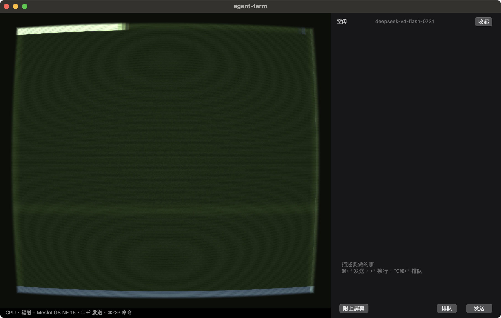
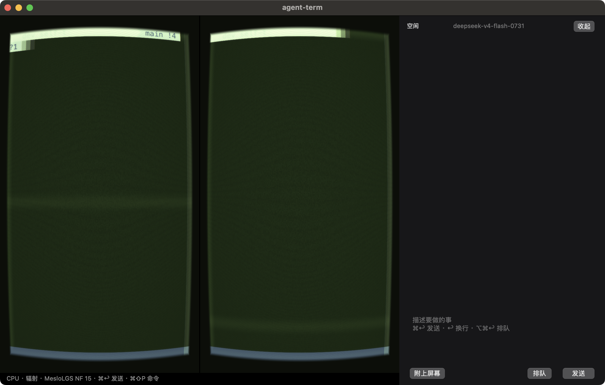

# agent-term

macOS 上的原生终端。一个窗口里嵌套分屏，旁边是带审批的本地 Agent。终端用 SwiftTerm，界面是 AppKit，不带 Electron。

选「辐射」主题时，每个面板盖一层 CRT：磷光、扫描线、暗角、圆角管框。其它主题是普通终端配色。

## 效果

单面板，右侧是 Agent 对话。状态空闲，模型名来自本机配置。



`⌘D` 左右分屏。新面板继承当前目录，分隔条可拖。



## 能做什么

- 登录 shell（`zsh -l`），`.zshrc` / `.bashrc` 生效。
- 嵌套分屏：`⌘D` 左右，`⌘⇧D` 上下。分隔条可拖，比例限制在 0.15–0.85。`⌘⌥方向键` 移动焦点，`⌘W` 关闭当前面板。
- 主题：默认、Nord、Dracula、Tokyo Night、Catppuccin、Solarized、Paper、辐射、琥珀、蓝。也可把 JSON 调色板放到 `~/.agent-term/themes/`。
- 字体、字号、行高、光标形状、透明度、Option 作为 Meta。`⌘=` / `⌘-` / `⌘0` 改字号，`⌘⇧P` 打开命令面板。
- Agent 侧栏：`⌘K` 打开。回复写在侧栏里，不灌进终端。
- 写文件和 shell 走审批。没有「允许」就不会执行。

## 快捷键

| 按键 | 作用 |
| --- | --- |
| `⌘D` | 左右分屏 |
| `⌘⇧D` | 上下分屏 |
| `⌘⌥方向键` | 移动焦点 |
| `⌘W` | 关闭当前面板 |
| `⌘,` | 设置 |
| `⌘K` | 打开 Agent |
| `⌘↩` | 发给 Agent |
| `⌘⌥↩` | 排队 |
| `⌘⌃↩` | 附上当前屏幕 |
| `⌘⇧P` | 命令面板 |

这些动作也在「窗口」和「Agent」菜单里。

## 配置

`~/.agent-term/config.json` 存字体、颜色、shell、模型地址和模型名。API Key 在登录钥匙串里，service `agent-term`，account `modelApiKey`，不写进配置文件。

Agent 循环不在这个仓库。运行时用 `AGENT_CORE` 指向 `@ppeng/agent-loop` 的 `dist/`，默认是旁边的 `../ppeng-agent-core/packages/agent-loop/dist/`。

## 编译运行

需要 Apple Silicon、macOS 14、Swift 6.1。SwiftTerm 固定在 v1.18.0。

```bash
scripts/build.sh
DYLD_LIBRARY_PATH=.build-direct .build-direct/TermApp
```

`scripts/build.sh` 把 headless 模块和 UI 模块分开放，互不覆盖，然后编 App、编审批用的 `gate`，并跑 TermCore 测试。
